<p align="center">
<picture>
  <source media="(prefers-color-scheme: dark)" srcset="assets/readme/banner-dark.svg">
  
</picture>
</p>

<p align="center">
  <a href="cad/blender/pod_v4/README.md"><b>Pod v4 build</b></a> &nbsp;·&nbsp;
  <a href="atlas/README.md"><b>3D part atlas</b></a> &nbsp;·&nbsp;
  <a href="docs/VISION.md"><b>Analytics pipeline</b></a> &nbsp;·&nbsp;
  <a href="docs/RESULTS.md"><b>Measured results</b></a> &nbsp;·&nbsp;
  <a href="app/README.md"><b>iOS app</b></a> &nbsp;·&nbsp;
  <a href="docs/FINDINGS.md"><b>Findings</b></a>
</p>

<p align="center">
  
  
  
  
  
  
</p>

<p align="center">
  <a href="https://github.com/Malek1414/hoopergpt/releases/download/devday-berlin-pitch/HooperGPT-pitch.mp4"><b>Watch the HooperGPT demo video (DevDay Hackathon Berlin, 88 s)</b></a>
  &nbsp;·&nbsp;
  <a href="https://github.com/Malek1414/hoopergpt/releases/tag/devday-berlin-pitch">Release page</a>
</p>

**A 3D-printed pan pod that turns the tripod you already own into an auto-tracking sports camera.**
FollowCam replaces the head of an ordinary tripod and steers a phone to follow the ball, for about
€20 in parts instead of a €2,000+ Veo or Pixellot unit. The same camera then keeps the stats: a
vision pipeline turns the footage into tracked players, jersey numbers, shot stats and a live score
overlay.

Built at the CODE University Berlin one-day hackathon (Aug 28, 2026). The pod is the
second-generation design; it replaced the original rig, which clamped a servo to the tripod's
centre column and pushed the pan handle with a printed fork arm.


<picture>
  <source media="(prefers-color-scheme: dark)" srcset="assets/readme/divider-dark.svg">
  
</picture>

## How it works

Phone in the pod's cradle streams to a laptop → OpenCV tracks the ball (HSV) →
laptop sends `A<angle>\n` over USB serial → the Arduino drives the servo → the
servo turns the **rotor** directly, on a Ø88 mm printed slew ring wrapped around
it, and the phone turns with the rotor.

The drive is direct and 1:1. There is no linkage: nothing rides a handle shaft,
so there is no lost motion between the servo horn and the camera. The firmware
keeps the original `A40`–`A140` command range and remaps it across the pod's full
180° of pan (×1.8), slew-rate limited to 30°/s with 60°/s² of acceleration, so the
camera tracks rather than snaps.

Portrait and landscape are two different cradles on the same keyed rotor socket:
one thumbscrew swaps them, no reprint. The tongue is offset forward so the pan
axis bisects the phone's thickness in both orientations, which is what keeps the
two orientations equally balanced.

The Arduino and its battery live in a separate case that clips onto a tripod leg,
so nothing rotates with the phone and no cable wraps the pan axis.

Walkthroughs: `cad/blender/pod_v4/FollowCam_Pod_v4.mov` (27.8 s, the pod itself)
and `viz/final/final.mov` (8 s, the motion synced to a court-coverage diagram).

Every part, what it does and what it bolts to, in an interactive 3D explorer:
[`atlas/`](atlas/README.md). Orbit, click any part, scrub the exploded view.

## Run the tracker

The laptop path is the primary demo: no signing and no Wi-Fi involved.

1. Wire the servo and its supply as in [`hardware/WIRING.md`](hardware/WIRING.md) and flash
   `software/servo_pod180/servo_pod180.ino` onto the Uno.
2. Install the tracker's dependencies: `pip install opencv-python pyserial`.
3. Run it:

```bash
python3 software/ball_tracker.py                    # webcam 0, no serial (preview only)
python3 software/ball_tracker.py --cam 1            # iPhone via Continuity Camera is often index 1
python3 software/ball_tracker.py --video clip.mp4   # test on a file
python3 software/ball_tracker.py --serial /dev/tty.usbserial-XXXX
```

Keys: `q` quits, `s` saves an HSV snapshot, and the trackbars tune the mask live.
`software/ball_tracker_yolo.py` has the same CLI and serial protocol but finds the ball with a
YOLO detector instead of a colour mask; the HSV tracker stays the fallback.

## Hardware

- A tripod with a removable head and a 1/4-20 screw (ours: MACTREM PT55). The pod
  takes the head's place; it does not clamp to anything.
- A standard-size hobby servo on the carrier plate, and an Arduino Uno R3 and its
  battery in the leg case.
- 12 printed parts. Print list, bed orientations, support notes and assembly order:
  [`cad/blender/pod_v4/README.md`](cad/blender/pod_v4/README.md).

**Two things to settle before you print part 05.** The CAD is cut for an **MG996R**
(`03_servo_carrier_MG996R.stl`, and the drive dog is dimensioned to the servo's
height), while the current firmware header specifies a **DS3218** 270° positional
servo. The drive dog is the one part sized to the servo, so measure the servo you
actually have; the pod README explains which of the two dogs to print. Likewise,
the leg case carries a 4 × AA bay, but the firmware calls for a regulated 6 V / 3 A
supply; AA alkalines sag hard under servo stall current, so bench-test the pack
before trusting it to a match.

Never power the servo from the Uno's 5 V pin. Use the external pack and common the
grounds; see `hardware/WIRING.md`.

## iOS app

`app/` is a SwiftUI camera app that runs on the phone in the rig. It records the game, tracks a
subject you tap with Apple's Vision framework, and sends pan angles over a WebSocket to
`software/pan_bridge.py` on the laptop, which forwards them to the Arduino. It also reads a
heart-rate strap during a session. The Xcode project is committed; build steps, the court test
flow and the unit tests (pan control law, heart-rate packet parser) are in
[`app/README.md`](app/README.md).

```
phone (app) --ws://laptop:8765--> software/pan_bridge.py --serial--> Arduino
```

<picture>
  <source media="(prefers-color-scheme: dark)" srcset="assets/readme/divider-dark.svg">
  
</picture>

## Analytics pipeline

The same camera keeps the stats. `vision/` turns a clip into labeled players,
ball and hoop, tracks with jersey numbers, a 2D court model, per-player shot
stats, a coach dashboard and a live score overlay. Stage by stage with the
exact commands, inputs, outputs and measured numbers: [`docs/VISION.md`](docs/VISION.md);
results of the fine-tune in [`docs/RESULTS.md`](docs/RESULTS.md); data handling
in [`docs/PRIVACY.md`](docs/PRIVACY.md).

```
.venv/bin/python -m vision.run_all --clip data/clips/dev60.mp4        # whole pipeline, or: make demo CLIP=...
.venv/bin/python -m vision.live.live --source 0 --minimap panel        # live score overlay from a camera
```

| Stage | Module | What it does |
|---|---|---|
| Labeling | `vision/label/` | Auto-labels frames with Grounding DINO (players, referees) and a ball/hoop model, removes static false balls, fine-tunes the detector |
| Tracking | `vision/track/` | YOLO players and ball/hoop with ByteTrack, team by jersey colour |
| Jersey numbers | `vision/numbers/` | EasyOCR on torso crops, merges tracks into numbered players |
| Court | `vision/court/` | 2D court model from a calibration |
| Stats | `vision/stats/` | Per-player shot stats |
| Dashboard | `vision/dashboard/` | Coach dashboard |
| Live | `vision/live/` | Live score overlay, MJPEG stream and `live_state.json` |
| QA, monitor | `vision/qa/`, `vision/monitor/` | Checks against hand labels; a status board on `http://127.0.0.1:8600` (`make monitor`) |
| Privacy | `vision/privacy/` | Data handling, see [`docs/PRIVACY.md`](docs/PRIVACY.md) |

`make demo`, `make smoke`, `make plan` and `make monitor` wrap these (see the `Makefile`).
Weights (`models/`), clips (`data/`) and outputs (`out/`) are gitignored, so the pipeline needs
them supplied locally.

One measured example from `docs/VISION.md`: after a fine-tune on Sami's hand-labeled frames, ball
recall on 40 held-out frames rose from 43 to 53 percent at conf 0.35, with 8 false positives
instead of 36.

## Broadcast overlays

`broadcast/` holds the "Big Ball Baller" overlay widgets (score bug, player card, lower third,
made-shot flash, team overview, heat map, end summary) as self-contained HTML, rendered to
transparent PNGs by `broadcast/render_widgets.py`. The live pipeline writes `out/live_state.json`
every second and serves it next to the MJPEG stream, and the widgets render from that state.
[`docs/BROADCAST.md`](docs/BROADCAST.md) is the contract, including how the iOS app is meant to
consume it. Set `FOLLOWCAM_RTMP_URL`
(see `.env.example`) to push the stream over RTMP.

## Repo map

| Path | What it is |
|------|-----------|
| `IDEA.md` | Pitch, market story, demo plan, fallback ladder |
| `PLAN.md` | Minute-by-minute hackathon execution plan |
| `docs/FINDINGS.md` | **All findings + decisions to date, summarized** |
| `cad/blender/pod_v4/` | **The current design**: `build_v4.py`, 12 verified STLs, renders, print + assembly handoff |
| `atlas/` | Interactive 3D part explorer for the pod (and the two hackathon headsets) |
| `cad/blender/` | Pod v3, superseded and kept for history. Does not build; do not print from `exports/` |
| `cad/` | OpenSCAD sources for the original pan-handle linkage, superseded |
| `print/` | Sliced `.bgcode` for the original linkage parts (0.4 nozzle, std + HF) |
| `software/ball_tracker.py` | HSV ball tracker → serial angle commands |
| `software/ball_tracker_yolo.py` | The same tracker with a YOLO ball detector |
| `software/pan_bridge.py` | WebSocket → serial bridge between the iOS app and the Arduino |
| `software/servo_pod180/` | **Current firmware**: `A<angle>` protocol remapped across the pod's 180° |
| `software/servo_pan/` | Original linkage firmware, superseded; do not flash onto the pod |
| `hardware/WIRING.md` | Wiring and power for the servo and the Uno |
| `app/` | SwiftUI iOS app: recording, tap-to-track, pan control, heart rate |
| `vision/` | Analytics pipeline, see above |
| `broadcast/` | Overlay widgets and their renderer |
| `ml/` | Early scripts: YOLO11 + ByteTrack tracking, pseudo-label fine-tune, NBA play-by-play labels, heart-rate vs event correlation, pan replay |
| `tripod-photos/`, `annotated/`, `assembly/` | Reference photos of the actual tripod and the assembly, with measurement callouts |
| `viz/` | Product poster (`make_pod_v4_poster.py` regenerates it), pan-demo video, edit plan |
| `pitch/` | Pitch outline, stage script, deck, demo videos |

## Workflow (read this, Sammy)

- `main` is protected: **all changes go through a PR reviewed by Malek**.
- Push feature branches (`sammy/<topic>`), open a PR, request review.
- Never commit render intermediates (`viz/work/`, frames, proxies). They're
  regenerable and gitignored.

<picture>
  <source media="(prefers-color-scheme: dark)" srcset="assets/readme/divider-dark.svg">
  
</picture>

<p align="center">
  <br>
  <sub>Built by <a href="https://github.com/Malek1414">Malek Hassan</a> in Berlin.</sub>
</p>
